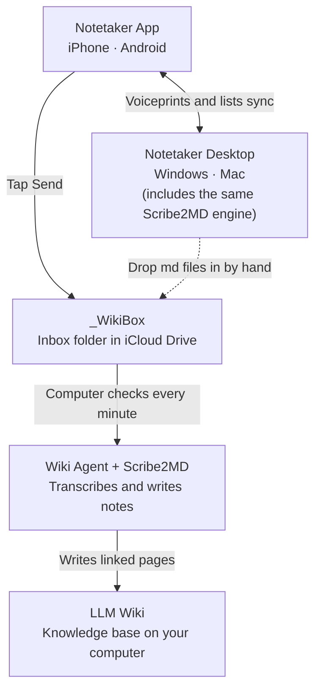

# How Notetaker Fits Together

**English** | [繁體中文](How-Notetaker-Fits-Together.zh-TW.md) | [简体中文](How-Notetaker-Fits-Together.zh-CN.md)

**Start with the Notetaker app on your phone, add Notetaker Desktop, and let Wiki Agent tie them together into an automated LLM Wiki. Three levels: install only as much as you need.**

## Level 1: Phone only

- Record, tell speakers apart, get a transcript
- Offline AI drafts the meeting notes
- Share with colleagues, or hand to ChatGPT or Claude

## Level 2: Add Notetaker Desktop

- Record online meetings, transcribe existing audio
- Turn Word, PDF and slides into AI-ready md
- Voiceprints and lists sync with your phone

Free for Windows and Mac: see the [Notetaker Desktop guide](https://github.com/VincentLiang1/notetaker-desktop/blob/main/README.md) (download links at the top).

## Level 3: Automatic knowledge base

- Tap Send; Wiki Agent on your computer picks it up
- Audio becomes text, filed into your LLM Wiki
- Links to what you already have, grows over time

Needs an always-on computer and a paid Claude plan (Pro or higher). For now the `_WikiBox` inbox folder lives in iCloud Drive: the phone is an iPhone, and a Windows PC needs iCloud for Windows. Wiki Agent checks the inbox every minute.

- New to LLM Wiki? See [What is an LLM Wiki?](What-is-LLM-Wiki.md)
- About Wiki Agent & setup: [README](README.md), [Mac install guide](Mac-Install-Guide.md), [Windows install guide](Windows-Install-Guide.md)

## What is Scribe2MD

- The transcription engine inside Notetaker Desktop
- Install it alone to just convert files, or for the doc2md skill in Claude Code
- Already included in Notetaker Desktop

The Wiki Agent installer offers to download Scribe2MD (about 1 GB, optional). Without it Claude reads documents and photos directly, and recordings and video wait until it is installed.
