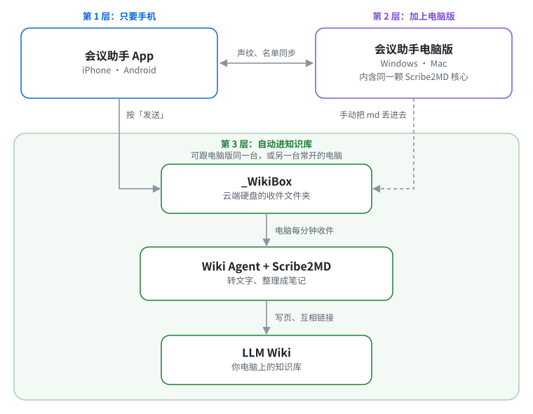

# 会议助手全套服务架构

[English](How-Notetaker-Fits-Together.md) | [繁體中文](How-Notetaker-Fits-Together.zh-TW.md) | **简体中文**

**从手机上的会议助手 App 开始,加上会议助手电脑版,再由 Wiki Agent 串起来,最后做到 LLM Wiki 自动化。分三层,要多少装多少。**

## 第 1 层:只要手机

- 录音、分出讲者、产生逐字稿
- 不上网 AI 整理成会议记录草稿
- 分享给同事,或交给 ChatGPT、Claude

## 第 2 层:加上电脑版

- 在电脑上录在线会议、转现成录音
- Word、PDF、演示文稿转成 AI 好读的 md
- 声纹与名单跟手机同步

免费下载,Windows 与 Mac 都有:看〈[会议助手电脑版使用手册](https://github.com/VincentLiang1/notetaker-desktop/blob/main/README.zh-CN.md)〉(开头就是下载链接)。

## 第 3 层:自动进知识库

- 手机按「发送」,电脑上的 Wiki Agent 收件
- 录音转文字,整理进你的 LLM Wiki
- 跟旧数据连起来,越用越完整

要一台常开的电脑与 Claude 付费账号(Pro 以上)。收件文件夹 `_WikiBox` 放在云端硬盘里,看你用什么送文件:iPhone 用 iCloud 云盘、Android 用 Google 云端硬盘;电脑版在 Windows 首选 OneDrive、在 Mac 首选 iCloud 云盘(另两个也可以)。安装时选要收哪几个,没选的不看。Wiki Agent 每分钟看一次收件文件夹。

- 没听过 LLM Wiki?看〈[什么是 LLM Wiki](What-is-LLM-Wiki.zh-CN.md)〉
- Wiki Agent 介绍与安装:[README](README.zh-CN.md)、[Mac 安装说明](Mac-Install-Guide.zh-CN.md)、[Windows 安装说明](Windows-Install-Guide.zh-CN.md)

## Scribe2MD 是什么

- 电脑版里负责转文字的核心
- 电脑版已经包含，要转文件、或在 Claude Code 用 doc2md 技能就装电脑版
- Wiki Agent 自动安装、自动更新，不用自己装

Wiki Agent 的安装程序会问要不要下载 Scribe2MD(约 1 GB,选装)。没装时文档与照片由 Claude 直接读,录音与视频要装了才处理。

- 能转哪些格式、怎么取得:看〈[Scribe2MD](Scribe2MD.zh-CN.md)〉
