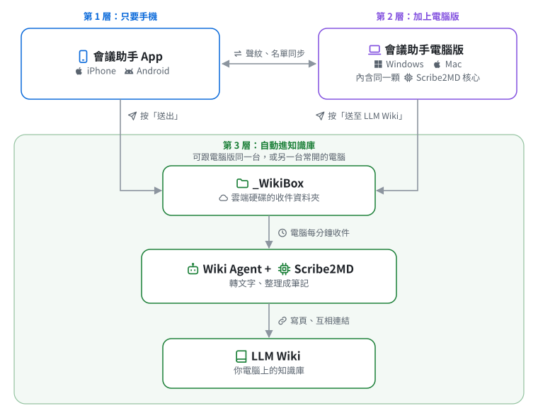

# 會議助手全套服務架構

[English](How-Notetaker-Fits-Together.md) | **繁體中文** | [简体中文](How-Notetaker-Fits-Together.zh-CN.md)

**從手機上的會議助手 App 開始,加上會議助手電腦版,再由 Wiki Agent 串起來,最後做到 LLM Wiki 自動化。分三層,要多少裝多少。**

## 第 1 層:只要手機

- 錄音、分出講者、產生逐字稿
- 不上網 AI 整理成會議紀錄草稿
- 分享給同事,或交給 ChatGPT、Claude

## 第 2 層:加上電腦版

- 在電腦上錄線上會議、轉現成錄音
- Word、PDF、簡報轉成 AI 好讀的 md
- 聲紋與名單跟手機同步

免費下載,Windows 與 Mac 都有:看〈[會議助手電腦版使用手冊](https://github.com/VincentLiang1/notetaker-desktop/blob/main/README.zh-TW.md)〉(開頭就是下載連結)。

## 第 3 層:自動進知識庫

- 手機按「送出」,電腦上的 Wiki Agent 收件
- 錄音轉文字,整理進你的 LLM Wiki
- 跟舊資料連起來,越用越完整
- 跟第 2 層可以是同一台電腦,也可以另用一台常開的電腦

要一台常開的電腦(可以就是裝電腦版那台)與 Claude 付費帳號(Pro 以上)。收件資料夾 `_WikiBox` 放在雲端硬碟裡,看你用什麼送檔:iPhone 用 iCloud 雲碟、Android 用 Google 雲端硬碟;電腦版在 Windows 首選 OneDrive、在 Mac 首選 iCloud 雲碟(另兩個也可以)。安裝時選要收哪幾個,沒選的不看。Wiki Agent 每分鐘看一次收件資料夾。

- 沒聽過 LLM Wiki?看〈[什麼是 LLM Wiki](What-is-LLM-Wiki.zh-TW.md)〉
- Wiki Agent 介紹與安裝:[README](README.zh-TW.md)、[Mac 安裝說明](Mac-Install-Guide.zh-TW.md)、[Windows 安裝說明](Windows-Install-Guide.zh-TW.md)

## Scribe2MD 是什麼

- 電腦版裡負責轉文字的核心
- 電腦版已經包含，要轉檔、或在 Claude Code 用 doc2md 技能就裝電腦版
- Wiki Agent 自動安裝、自動更新，不用自己裝

Wiki Agent 的安裝程式會問要不要下載 Scribe2MD(約 1 GB,選裝)。沒裝時文件與照片由 Claude 直接讀,錄音與影片要裝了才處理。

- 能轉哪些格式、怎麼取得:看〈[Scribe2MD](Scribe2MD.zh-TW.md)〉
